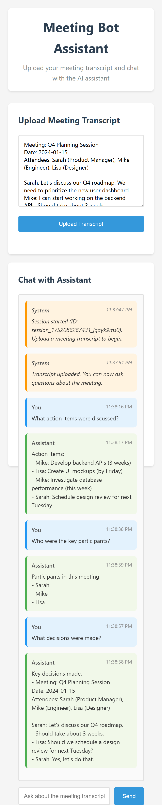

# Meeting Bot

[](https://github.com/waleedarif1011/meeting-bot/actions/workflows/ci.yml)
[](LICENSE)

> **Live Demo:** _Coming soon — deploy steps below. Set `frontend/config.js` `API_BASE_URL` to your Flask host, then deploy `frontend/` to Vercel._

Upload a meeting transcript (or load the built-in sample) and chat for **summaries**, **action items**, **decisions**, **topics**, and **participants**.



## Features

- One-click **Load sample meeting** for instant demos
- TextRank summarization (Sumy + NLTK) — no LLM API key required
- Extraction of attendees, action items, decisions, and topics
- Stateless session chat over a small Flask API
- Static UI ready for Vercel; API ready for Railway or Render

## Architecture

```
┌─────────────────────┐       HTTPS        ┌──────────────────────┐
│  Frontend (Vercel)  │ ─────────────────► │  Flask API           │
│  HTML / CSS / JS    │                    │  Railway / Render    │
└─────────────────────┘                    │         │            │
                                           │         ▼            │
                                           │  chatbot/engine.py   │
                                           │  Sumy TextRank + NLP │
                                           └──────────────────────┘
```

## Quick start (local)

```bash
python -m venv .venv && source .venv/bin/activate
pip install -r requirements.txt
python server.py
```

In another terminal:

```bash
cd frontend && python -m http.server 3000
```

Open http://localhost:3000 — or use `./start-dev.sh` inside the Dev Container ([DEV_SETUP.md](DEV_SETUP.md)).

## API

| Method | Path | Purpose |
|--------|------|---------|
| `GET` | `/health` | Health check (`{"status":"ok"}`) |
| `GET` | `/sample` | Built-in Q4 planning transcript |
| `POST` | `/upload` | `{ "transcript": "...", "session_id": "..." }` |
| `POST` | `/chat` | `{ "message": "...", "session_id": "..." }` → `{ "response": "..." }` |

CORS is enabled. Bind port via `PORT` (default `5000`).

## Deploy

### 1. Flask API (Railway or Render)

**Railway**

1. New project → Deploy from GitHub → select this repo.
2. Start command: `python server.py` (or use the included `Procfile`).
3. Set Python to 3.11 if prompted (`runtime.txt` pins 3.11.9).
4. Copy the public URL (e.g. `https://meeting-bot-api.up.railway.app`).

**Render**

1. New **Web Service** → connect this repo.
2. Build: `pip install -r requirements.txt`
3. Start: `python server.py`
4. Instance type: free/starter is enough for demos.

Confirm: `curl https://YOUR-API-HOST/health` → `{"status":"ok"}`.

### 2. Frontend (Vercel)

1. Update `frontend/config.js`:

   ```js
   window.API_BASE_URL = "https://YOUR-API-HOST";
   ```

2. Deploy with the repo-root `vercel.json` (serves `frontend/` as static files):

   ```bash
   npx vercel --prod
   ```

   Or: Vercel Dashboard → Import Git repo → Framework Preset **Other** → root directory `.` (uses `vercel.json`).

3. Open the Vercel URL → **Load sample meeting** → ask e.g. “What were the action items?”

> **Note:** Live demo URL is a placeholder until API + Vercel credentials are available in this environment. After you deploy, replace the Live Demo line at the top of this README with your Vercel URL.

## Tests

```bash
pip install -r requirements.txt
pytest -q
```

CI runs the same suite on every push/PR via [.github/workflows/ci.yml](.github/workflows/ci.yml).

## Project layout

```
meeting-bot/
├── frontend/           # Static UI (Vercel)
│   ├── config.js       # API_BASE_URL
│   ├── index.html
│   ├── script.js
│   └── style.css
├── chatbot/
│   ├── engine.py       # NLP extraction + TextRank
│   └── README.md
├── tests/
├── server.py           # Flask API
├── vercel.json
├── Procfile            # Railway/Render
└── requirements.txt
```

More detail: [chatbot/README.md](chatbot/README.md) · [DEV_SETUP.md](DEV_SETUP.md)

## License

MIT — see [LICENSE](LICENSE).
